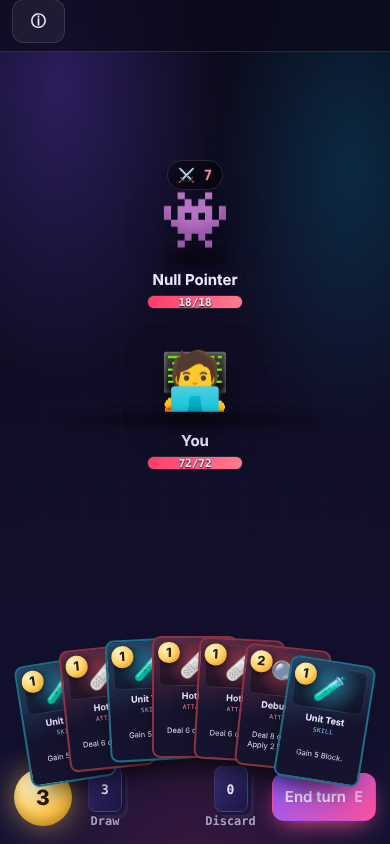
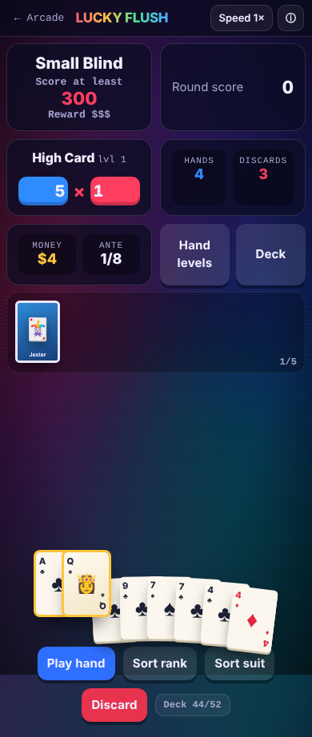

# Shen Majun · Portfolio

Applied Data Science student at Monash University Malaysia. Interests: AI, data science and back-end development.

**[Open the portfolio](https://respooner.github.io/)** · **[Play Mini Arcade](https://respooner.github.io/mini-arcade/)** · [Email](mailto:shenmajun683@gmail.com)

## Selected projects

| Project | Focus | Demo / materials | Source status |
| --- | --- | --- | --- |
| Malaysia dengue pipeline | Weekly data integration, quality control and reproducibility | [Project](https://respooner.github.io/#pipeline) · [Methods and evidence](https://respooner.github.io/projects/research.html#dengue) | Website visualization is public; research scripts and run artifacts are not included here. |
| NHANES risk models | Collaborative research, temporal validation and model interpretation | [Project](https://respooner.github.io/#models) · [Preprint](https://www.medrxiv.org/content/10.64898/2026.10.09.26365176v1) | Preprint, not yet peer reviewed; analysis code is not included here. |
| Bug Slayer | Async turn engine, data-driven cards and procedural routes | [Play](https://respooner.github.io/mini-arcade/bug-slayer.html) · [Notes](https://respooner.github.io/mini-arcade/project-notes.html#bug-slayer) | [HTML / JavaScript](mini-arcade/bug-slayer.html) |
| Lucky Flush | Poker evaluator, ordered scoring and hook-based rules | [Play](https://respooner.github.io/mini-arcade/lucky-flush.html) · [Notes](https://respooner.github.io/mini-arcade/project-notes.html#lucky-flush) | [HTML / JavaScript](mini-arcade/lucky-flush.html) |
| Neon Crypt | Procedural dungeons, shadowcasting and BFS pathfinding | [Play](https://respooner.github.io/mini-arcade/neon-crypt.html) · [Notes](https://respooner.github.io/mini-arcade/project-notes.html#neon-crypt) | [HTML / JavaScript](mini-arcade/neon-crypt.html) |

<p></p>

Gameplay captures are retained from the 24 October 2026 project history. See the live demos for current behavior.

## Contribution and evidence

- The website and games use AI coding assistance; the original game commit records assistant attribution. Source, technical notes and commit history are public.
- Research contribution scope and public-material availability are documented on the [research materials page](https://respooner.github.io/projects/research.html).
- The doorway animation uses simulated data. Research metrics and charts reproduce the existing portfolio's reported results; this website is not a runnable release of either research analysis.

## Run locally

```sh
git clone https://github.com/respooner/respooner.github.io.git
cd respooner.github.io
python3 -m http.server 8000
```

Open `http://localhost:8000/`. No npm installation or build is needed. Each game can also be opened as a standalone HTML file. External fonts are optional; game scores use browser-local storage.

## Structure

| Path | Purpose |
| --- | --- |
| `index.html` | Canonical, general-purpose portfolio homepage |
| `assets/` | One shared set of portfolio CSS, JavaScript and gameplay previews |
| `projects/research.html` | Research methods, contribution scope and evidence boundaries |
| `mini-arcade/` | Game hub, three playable games and project notes |
| `applications/footfallcam/` | Tailored application page, kept separate from the general homepage |
| `shen-majun-portfolio/`, `games/` | Compatibility redirects for previously shared URLs |
| `.nojekyll` | Publish the static files directly |

## Deploy and maintain

GitHub Pages publishes `main` from `/(root)`. Edit the root homepage and shared `assets/`; do not upload another enclosing portfolio folder. Review the Pages build/deployment result in [Actions](https://github.com/respooner/respooner.github.io/actions) after pushing.

Before publishing, check the homepage → Arcade → game → Arcade → homepage route, legacy redirects, project anchors and the contact link. `python3 scripts/check_links.py` checks local HTML targets and section anchors. Use a browser to check charts, themes, game controls and narrow-screen layouts.

The tailored FootfallCam page is at `/applications/footfallcam/`; it is excluded from indexing with a `noindex` tag. Keep its claims consistent with the shared portfolio.

## Sources and attribution

The dengue presentation cites OpenDengue V1.3 (CC BY 4.0). The NHANES preprint credits Zhan X, Shen M, Zhang Y and Mao X. A data source's license does not imply a license for all repository code or assets; no repository-wide software license is currently declared.
